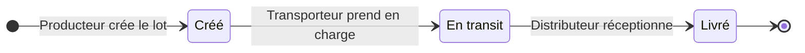

# Cahier des charges · Projet TraceLot

Version 1.0 · 25 novembre 2026

## 1. Présentation du document

Ce cahier des charges décrit l'application TraceLot à concevoir, développer et déployer dans le cadre du module Développement Blockchain (BLOE562). Il précise le besoin du client, les exigences attendues, les contraintes techniques, les livrables et les critères d'évaluation.

| Élément | Valeur |
| --- | --- |
| Projet | TraceLot, registre de traçabilité de lots de marchandises |
| Client | Consortium TraceLot (cas fictif à visée pédagogique) |
| Prestataire | L'apprenant, seul ou en binôme |
| Module | BLOE562 · Développement Blockchain · CDA 3e année |
| Compétences visées | 1.3 Développer des composants métiers · 2.2 Définir l'architecture logicielle d'une application |
| Date de remise | 14 décembre 2026 |
| Version du document | 1.0 |

Le document est rédigé comme un cahier des charges professionnel. Chaque exigence porte un identifiant (EF pour fonctionnelle, ENF pour non fonctionnelle, RG pour règle de gestion) afin de pouvoir y faire référence dans le code, les tests et la note d'architecture.

## 2. Glossaire

| Terme | Définition |
| --- | --- |
| ABI | Description JSON des fonctions et événements d'un contrat. Elle permet à une application d'appeler le contrat. |
| Adresse | Identifiant de 20 octets (0x suivi de 40 caractères hexadécimaux) d'un compte ou d'un contrat sur Ethereum. |
| Blockchain | Registre distribué dans lequel les transactions sont regroupées en blocs chaînés par hachage et ajoutées par consensus. |
| Bytecode | Code compilé d'un contrat, exécuté par l'EVM. |
| Consortium | Réseau blockchain dont les validateurs sont des organisations identifiées. |
| Déploiement | Transaction qui dépose le bytecode d'un contrat sur la chaîne et lui attribue une adresse. |
| Distributeur | Acteur qui réceptionne un lot et le met en vente. |
| Empreinte | Résultat d'une fonction de hachage (keccak256 sur Ethereum). Sert à identifier un document sans le publier. |
| Étape | Changement d'état d'un lot, déclaré par un acteur habilité (création, prise en charge, livraison). |
| Événement | Trace émise par un contrat lors d'une action, lisible par les applications. |
| EVM | Ethereum Virtual Machine : machine virtuelle qui exécute les contrats sur chaque nœud. |
| Gas | Unité qui mesure le travail de calcul et de stockage d'une transaction. Les frais valent le gas consommé multiplié par son prix. |
| Hardhat | Environnement de développement pour compiler, tester et déployer des contrats Solidity. |
| Hors chaîne | Données ou traitements conservés en dehors de la blockchain (fichiers, base de données). |
| Lot | Ensemble de marchandises suivi comme une unité, identifié par une référence unique. |
| Nœud | Machine qui détient une copie du registre, vérifie et relaie les transactions. |
| Producteur | Acteur qui fabrique les marchandises et crée le lot. |
| Rôle | Habilitation attribuée à une adresse, qui détermine les actions qu'elle peut réaliser. |
| Smart contract | Programme déployé à une adresse sur une blockchain, exécuté et vérifié par tous les nœuds. |
| Testnet | Réseau public de test (par exemple Sepolia) dont la cryptomonnaie n'a pas de valeur. |
| Transaction | Opération signée par un compte, qui modifie l'état de la blockchain. |
| Transporteur | Acteur qui prend en charge un lot et l'achemine jusqu'au distributeur. |
| Wallet | Logiciel qui conserve les clés privées d'un utilisateur et signe les transactions après son consentement (par exemple MetaMask). |

## 3. Contexte et problématique

Le consortium TraceLot réunit trois types d'entreprises indépendantes qui interviennent sur une même chaîne d'approvisionnement : des producteurs, des transporteurs et des distributeurs. Chaque lot de marchandises passe successivement entre leurs mains.

Aujourd'hui, chaque entreprise trace les lots dans son propre outil. Les informations ne concordent pas toujours, et en cas de litige (lot perdu, livraison contestée, retard), personne ne peut prouver qui a fait quoi et quand. Aucun des membres n'accepte de confier la gestion du registre commun à un autre membre, ni à un prestataire unique.

Le consortium souhaite donc un registre partagé dans lequel :

- chaque acteur déclare lui-même les étapes qui le concernent ;
- aucune déclaration ne peut être modifiée ou supprimée après coup ;
- tout membre peut consulter l'historique complet d'un lot et savoir qui a déclaré chaque étape, et quand.

## 4. Objectifs et périmètre

### 4.1 Objectifs

1. Garantir l'intégrité de l'historique de chaque lot : une étape déclarée ne peut plus être modifiée.
2. Garantir la traçabilité : chaque étape indique l'acteur qui l'a déclarée et sa date.
3. Appliquer automatiquement les règles métier : seul l'acteur habilité peut déclarer une étape, et dans le bon ordre.
4. Offrir une interface simple pour déclarer une étape et consulter l'historique d'un lot.
5. Justifier le choix d'une architecture blockchain et en identifier les limites.

### 4.2 Périmètre

| Inclus dans le projet | Exclu du projet |
| --- | --- |
| Un smart contract de traçabilité des lots | La gestion des stocks, des commandes et de la facturation |
| La gestion des rôles (producteur, transporteur, distributeur) | L'authentification par identifiant et mot de passe |
| Les tests automatisés du contrat | Le déploiement sur le réseau principal Ethereum |
| Une application web connectée à un wallet | Une application mobile |
| Le déploiement sur un réseau local ou un testnet | Le paiement en cryptomonnaie |
| Une note d'architecture | Le stockage des documents des lots (bons de livraison, factures) |

## 5. Acteurs et cycle de vie d'un lot

### 5.1 Acteurs

| Acteur | Rôle dans l'application | Actions autorisées |
| --- | --- | --- |
| Administrateur du consortium | Compte qui déploie le contrat | Attribuer et retirer les rôles |
| Producteur | Fabrique les marchandises | Créer un lot |
| Transporteur | Achemine les lots | Prendre en charge un lot créé |
| Distributeur | Reçoit et vend les lots | Réceptionner un lot en transit |
| Membre du consortium ou auditeur | Consulte le registre | Consulter un lot et son historique |

### 5.2 Cycle de vie d'un lot

Un lot passe par trois états, toujours dans cet ordre. Chaque passage est déclaré par l'acteur qui en a le rôle, et devient définitif une fois inscrit. Aucun retour à un état précédent n'est possible.

## 6. Exigences fonctionnelles

La priorité suit la méthode MoSCoW : **Doit** (indispensable), **Devrait** (important), **Pourrait** (bonus).

### 6.1 Smart contract

| ID | Exigence | Critère d'acceptation | Priorité |
| --- | --- | --- | --- |
| EF-01 | L'administrateur attribue un rôle (producteur, transporteur, distributeur) à une adresse. | Seul l'administrateur peut attribuer un rôle ; toute autre adresse est refusée. | Doit |
| EF-02 | L'administrateur retire un rôle à une adresse. | L'adresse ne peut plus réaliser les actions de ce rôle. | Devrait |
| EF-03 | Un producteur crée un lot à partir de sa référence. | Le lot passe à l'état Créé ; le producteur et la date sont enregistrés. | Doit |
| EF-04 | Un transporteur prend en charge un lot créé. | Le lot passe à l'état En transit ; le transporteur et la date sont enregistrés. | Doit |
| EF-05 | Un distributeur réceptionne un lot en transit. | Le lot passe à l'état Livré ; le distributeur et la date sont enregistrés. | Doit |
| EF-06 | Toute personne consulte l'état courant d'un lot. | La lecture renvoie l'état et les acteurs de chaque étape déjà franchie, sans frais. | Doit |
| EF-07 | Chaque étape émet un événement. | L'événement contient la référence du lot, l'acteur et le nouvel état. | Doit |
| EF-08 | Chaque refus renvoie une erreur explicite. | Une erreur personnalisée distincte par cas de refus (rôle manquant, lot inconnu, lot déjà existant, étape hors ordre). | Doit |
| EF-09 | Un producteur associe à la création l'empreinte d'un document du lot (bon de fabrication). | L'empreinte est stockée ; le document lui-même reste hors chaîne. | Pourrait |

### 6.2 Application web

| ID | Exigence | Critère d'acceptation | Priorité |
| --- | --- | --- | --- |
| EF-10 | L'utilisateur connecte son wallet. | L'adresse connectée et son rôle s'affichent. | Doit |
| EF-11 | L'utilisateur déclare l'étape qui correspond à son rôle. | Après confirmation dans le wallet, la page affiche le hash de la transaction et le numéro de bloc. | Doit |
| EF-12 | L'utilisateur recherche un lot par sa référence. | La page affiche l'état courant et l'historique : acteur et date de chaque étape. | Doit |
| EF-13 | Les erreurs sont expliquées à l'utilisateur. | Un message clair pour chaque erreur du contrat et pour une signature refusée dans le wallet. | Doit |
| EF-14 | L'application affiche en direct les nouvelles étapes déclarées. | La liste se met à jour à chaque événement, sans recharger la page. | Pourrait |
| EF-15 | Le dépôt d'un document calcule son empreinte dans le navigateur (lié à EF-09). | Le fichier ne quitte pas le poste de l'utilisateur. | Pourrait |

## 7. Règles de gestion

| ID | Règle |
| --- | --- |
| RG-01 | Un lot est identifié par une référence unique. Deux lots ne peuvent pas avoir la même référence. |
| RG-02 | Les états d'un lot se succèdent toujours dans l'ordre Créé, En transit, Livré. Aucune étape ne peut être sautée. |
| RG-03 | Aucune étape déclarée ne peut être modifiée, annulée ou supprimée. |
| RG-04 | Une étape ne peut être déclarée que par une adresse qui possède le rôle correspondant au moment de la déclaration. |
| RG-05 | Seul l'administrateur attribue et retire les rôles. L'administrateur est le compte qui déploie le contrat. |
| RG-06 | Une même adresse peut cumuler plusieurs rôles. |
| RG-07 | La date d'une étape est celle du bloc qui contient la transaction. |
| RG-08 | La consultation d'un lot est ouverte à tous et ne nécessite pas de wallet. |
| RG-09 | Aucune donnée personnelle ni aucun document n'est inscrit sur la chaîne. La référence d'un lot ne doit pas contenir d'information personnelle. |

## 8. Exigences non fonctionnelles

| ID | Catégorie | Exigence |
| --- | --- | --- |
| ENF-01 | Sécurité | Toute fonction qui modifie l'état vérifie le rôle de l'appelant avec msg.sender, jamais tx.origin. |
| ENF-02 | Sécurité | Les fonctions suivent l'ordre vérifier, modifier l'état, puis interagir. |
| ENF-03 | Sécurité | Le contrat ne contient aucune boucle sur une liste qui grandit sans limite. |
| ENF-04 | Sécurité | Aucune clé privée ni phrase de récupération n'apparaît dans le code ou le dépôt. Les secrets éventuels sont dans un fichier exclu du dépôt. |
| ENF-05 | Qualité | Chaque fonction et chaque cas de refus sont couverts par au moins un test automatisé, et tous les tests passent. |
| ENF-06 | Qualité | Le code est lisible, commenté aux endroits utiles, et compile sans avertissement. |
| ENF-07 | Sobriété | Le contrat stocke le minimum de données nécessaire. Les informations détaillées restent hors chaîne. |
| ENF-08 | Confidentialité | Aucune donnée personnelle sur la chaîne (voir RG-09). |
| ENF-09 | Ergonomie | L'utilisateur sait à tout moment si sa transaction est en attente, confirmée ou refusée. |
| ENF-10 | Maintenabilité | Le projet s'installe et se lance en suivant uniquement le README. |

## 9. Contraintes techniques et architecture attendue

### 9.1 Contraintes techniques

| Élément | Contrainte |
| --- | --- |
| Langage du contrat | Solidity 0.8.24 ou plus récent |
| Environnement | Hardhat 3 (Node.js 22.13 ou plus récent) |
| Tests | Tests automatisés avec Hardhat (Mocha et Chai, ou équivalent) |
| Bibliothèque d'interaction | ethers.js v6 |
| Wallet | MetaMask |
| Réseau | Réseau local Hardhat ou testnet Sepolia. Le réseau principal est exclu. |
| Front | Libre : HTML et JavaScript, Vite, React ou équivalent |
| Bibliothèques autorisées | OpenZeppelin Contracts (par exemple AccessControl pour les rôles) |
| Gestion de version | Git, dépôt hébergé sur GitHub |

### 9.2 Architecture attendue

L'application suit l'architecture d'une application décentralisée vue en cours :

- **Sur la chaîne** : le smart contract, qui contient les rôles, l'état de chaque lot et les acteurs et dates de chaque étape.
- **Dans le navigateur** : l'application web, qui lit le contrat sans frais et fait signer les écritures par le wallet.
- **Hors chaîne** : tout le reste (descriptif détaillé des lots, documents, informations sur les entreprises), qui n'est pas à développer dans ce projet.

Les choix d'architecture sont justifiés dans la note d'architecture (voir section 10).

## 10. Livrables, modalités et critères d'évaluation

### 10.1 Livrables

Tous les livrables sont rassemblés dans un fork du dépôt de départ, en respectant sa structure de dossiers.

| Livrable | Contenu attendu | Emplacement dans le dépôt |
| --- | --- | --- |
| Smart contract | Le contrat TraceLot, compilable sans avertissement | contracts/ |
| Tests | Les tests automatisés du contrat, tous au vert | test/ |
| Script de déploiement | Déploiement sur réseau local ou Sepolia | ignition/ ou scripts/ |
| Application web | L'interface connectée au contrat | front/ |
| README | Prérequis, installation, lancement du réseau, déploiement, lancement des tests et de l'application | racine |
| Note d'architecture | Une page : pourquoi une blockchain, quel modèle (publique, privée, consortium), ce qui est sur ou hors chaîne, au moins trois limites de la solution | docs/ |

### 10.2 Modalités

| Élément | Modalité |
| --- | --- |
| Organisation | Seul ou en binôme |
| Date de remise | 14 décembre 2026 |
| Dépôt de départ | Dépôt GitHub public fourni par l'intervenant : [github.com/Septsept/2627-EPSI-B3-CDA-Blockchain](https://github.com/Septsept/2627-EPSI-B3-CDA-Blockchain) |
| Format de rendu | Un fork du dépôt de départ par apprenant ou par binôme. Seul le travail poussé sur ce fork au 14 décembre 2026 est évalué. |
| Binôme | Un seul fork par binôme. Les noms des deux membres figurent dans le README. |

### 10.3 Critères d'évaluation

| Critère | Ce qui est attendu | Exigences liées |
| --- | --- | --- |
| Fonctionnement | Les étapes d'un lot s'enchaînent dans le bon ordre et chaque action émet un événement. | EF-01 à EF-08, RG-01 à RG-07 |
| Sécurité | Contrôle d'accès par rôle, msg.sender, aucune boucle non bornée, ordre vérifier, modifier, interagir. | ENF-01 à ENF-04 |
| Tests | Au moins un test par fonction et par cas de refus, tous au vert. | ENF-05 |
| Intégration | Lecture et écriture depuis la page, wallet connecté, erreurs expliquées à l'utilisateur. | EF-10 à EF-13, ENF-09 |
| Analyse critique | Choix du modèle justifié, données hors chaîne identifiées, au moins trois limites. | Note d'architecture |
| Qualité | README complet, code lisible et commenté, commits réguliers. | ENF-06, ENF-10 |

Les exigences de priorité Pourrait sont des bonus : elles valorisent le travail mais leur absence n'est pas pénalisée.
